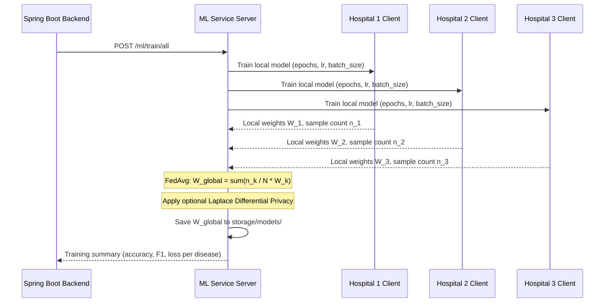

# FedMed AI — Machine Learning & Federated Learning Service

> Multi-Disease Inference Engine, FedAvg Aggregator & Clinical Decision Support

The FedMed AI ML service is an asynchronous Python service built on FastAPI. It executes multi-disease predictive risk scoring, coordinates decentralized federated model training across hospital nodes using Federated Averaging (`FedAvg`), and provides LLM-based clinical decision support.

For the system-wide architecture and backend orchestrator details, refer to the [Root README](../README.md).

---

## Technology Stack

- **Runtime & Serving:** Python 3.12, FastAPI 0.115.0, Uvicorn 0.30.6 (ASGI server)
- **Machine Learning Libraries:** scikit-learn 1.5.2, NumPy 1.26.4, Pandas 2.2.3, SciPy 1.14.1
- **Federated Learning:** Custom sample-weighted Federated Averaging (`FedAvg`), Flower framework integration (`flwr`)
- **Imbalance Handling:** Imbalanced-learn (SMOTE) applied during node training
- **Serialization:** Joblib 1.4.2 (model state persistence in `storage/models/`)
- **Clinical Synthesis:** OpenRouter API (`meta-llama/llama-3.1-8b-instruct`) with local rule-based fallback
- **Report Generation:** ReportLab 4.2.5 (PDF diagnostic report compilation)
- **Validation:** Pydantic v2.9.2

---

## Implemented Disease Models & Feature Requirements

The service maintains separate trained classification models (LogisticRegression or RandomForest) for 5 distinct clinical conditions:

| Disease | Clinical Features Required | Key Feature Inputs | Model Artifact |
| :--- | :--- | :--- | :--- |
| **Heart Disease** | 13 features | Age, sex, chest pain type, resting BP, cholesterol, fasting blood sugar, ECG, max HR, ST depression | `heart_disease_global_model.pkl` |
| **Diabetes** | 8 features | Pregnancies, glucose, blood pressure, skin thickness, insulin, BMI, pedigree function, age | `diabetes_global_model.pkl` |
| **Chronic Kidney Disease** | 18 features | Age, blood pressure, specific gravity, albumin, sugar, creatinine, hemoglobin, urea, electrolytes | `kidney_disease_global_model.pkl` |
| **Liver Disease** | 10 features | Age, gender, total/direct bilirubin, alkaline phosphatase, ALT/AST enzymes, total proteins, albumin | `liver_disease_global_model.pkl` |
| **Stroke** | 10 features | Gender, age, hypertension, heart disease history, glucose level, BMI, smoking status | `stroke_global_model.pkl` |

---

## Inference Workflow & Model Loading

1. **Feature Ingestion:** The endpoint `POST /ml/predict` accepts an 18-element general clinical feature vector from the backend.
2. **Feature Mapping:** `app/routes/prediction_routes.py` maps the general features into each disease model's specific feature format using `map_general_to_disease()`.
3. **Model Execution:** Serialized models are loaded from `storage/models/{disease}_global_model.pkl` via `model_store.py`. For each condition, `model.predict()` and `model.predict_proba()` generate a binary prediction and continuous probability score.
4. **Risk Stratification:** Probabilities are mapped into categorical risk tiers:
   - `HIGH`: $\ge 70\%$ confidence
   - `MODERATE`: $40\% - 69\%$ confidence
   - `LOW`: $20\% - 39\%$ confidence
   - `MINIMAL`: $< 20\%$ confidence
5. **Clinical Decision Support:** 
   - When enabled, `RecommendationEngine` dispatches the results to the OpenRouter API (`meta-llama/llama-3.1-8b-instruct`) to generate personalized lifestyle advice and test recommendations.
   - If OpenRouter is unreachable, rate-limited, or disabled, it falls back to a deterministic local rule-based expert system (`_rule_based()`).

---

## Federated Learning Workflow

The service supports decentralized model training across multiple hospital nodes without raw data exchange:



- **Federated Averaging (`FedAvg`):** Aggregates node model coefficients proportionally to the number of patient samples trained at each hospital node.
- **Class Imbalance Mitigation:** Automatically detects skewed local class distributions and applies SMOTE oversampling during node training.
- **Differential Privacy (Optional):** Supports calibrated Laplace noise injection into aggregated model weights via `app/federated/differential_privacy.py` (`dp_epsilon` parameter).

---

## Verified API Endpoints

| Endpoint | Method | Input Payload | Output Summary |
| :--- | :--- | :--- | :--- |
| `/ml/health` | `GET` | None | Service liveness probe (`{"status": "UP"}`) |
| `/ml/predict` | `POST` | `{"features": [18 floats]}` | Multi-disease predictions, risk levels, and clinical recommendations |
| `/ml/predict/single/{disease}` | `POST` | `{"features": [...]}` | Targeted evaluation for a single condition |
| `/ml/train` | `POST` | `TrainRequest` | Local training execution for a specific hospital node |
| `/ml/train/all` | `POST` | `TrainAllRequest` | Full multi-node federated training round across all 5 disease models |
| `/ml/aggregate` | `POST` | `AggregateRequest` | Manual execution of FedAvg on supplied client weights |
| `/ml/analytics/full` | `GET` | None | Federated training round statistics and per-disease metrics |
| `/ml/models/info` | `GET` | None | Model version metadata, active status, and sample counts |
| `/ml/report/generate` | `POST` | Patient metadata & predictions | Generates a binary PDF diagnostic summary report |

---

## Environment Variables

| Variable | Default Value | Purpose |
| :--- | :--- | :--- |
| `PORT` | `8000` | Port on which Uvicorn binds the FastAPI server. |
| `ENVIRONMENT` | `production` | Execution mode (`development` enables hot reload). |
| `OPENROUTER_API_KEY` | *(empty)* | Optional API key for OpenRouter LLM clinical recommendation generation. When omitted, the service operates entirely offline using the local rule-based engine. |

---

## Local Development & Execution

### Prerequisites
- Python 3.12+
- `pip` package manager

### 1. Setup Virtual Environment
```bash
cd "federated learning medical diagnosis/fl/ml-service"

# Create and activate virtual environment
python3 -m venv .venv
source .venv/bin/activate

# Install required dependencies
pip install -r requirements.txt
```

### 2. Start ML Service Locally
```bash
uvicorn main:app --host 0.0.0.0 --port 8000 --reload
```
Interactive OpenAPI documentation will be accessible at `http://localhost:8000/docs`.

### 3. Verify Health & Inference via cURL
```bash
# Health probe
curl -s http://localhost:8000/ml/health

# Multi-disease test inference
curl -s -X POST http://localhost:8000/ml/predict \
  -H "Content-Type: application/json" \
  -d '{"features": [55, 1, 145, 240, 78, 110, 27.5, 1, 1, 0, 1.1, 14.0, 0.8, 35, 4.2, 4.5, 140, 25]}'
```

---

## Docker Container Deployment

The service is packaged using a multi-stage `Dockerfile`:
- Uses `python:3.12-slim` as builder to install packages into a virtual environment (`/opt/venv`).
- Copies `/opt/venv` and source code into an unprivileged runtime image running as non-root user `appuser`.

```bash
# Build Docker image
docker build -t fl-medical-ml-service:latest .

# Run standalone container
docker run -d \
  --name fl_ml_service \
  -p 8000:8000 \
  fl-medical-ml-service:latest
```

---

## Healthcare AI Disclaimer & Limitations

- **Not a Diagnostic Device:** FedMed AI is an academic and research proof-of-concept demonstrating federated learning on tabular medical data. It has not undergone clinical validation trials and is not registered with any regulatory body (such as FDA or EMA).
- **Synthetic & Benchmark Datasets:** Initial model weights are trained on public benchmarks (Cleveland Heart, Pima Diabetes, Indian Liver Patient, Healthcare Stroke Dataset). Accuracy metrics reflect benchmark performance and should not be assumed representative of real-world clinical distributions.
- **No Direct Medical Advice:** Automated clinical decision support notes generated by OpenRouter or the rule engine are assistive recommendations intended for review by licensed medical practitioners, not for direct patient consumption.
